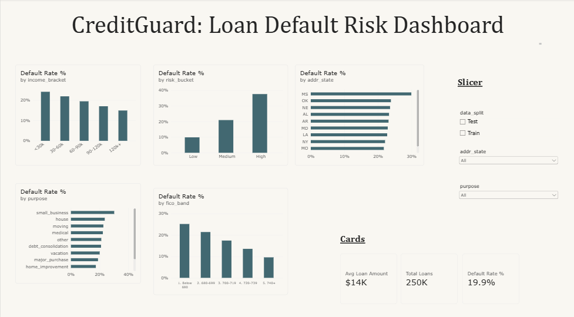

# CreditGuard: Loan Default Risk Analysis

An end-to-end analytics project that cleans real lending data, finds which
borrower segments default most, predicts default risk with Logistic Regression,
and presents everything in an interactive Power BI dashboard.



## Key findings (250,000 Lending Club loans, 19.9% default rate)
- **Credit score is the strongest pattern:** default falls from 25.1% (FICO below 680) to 9.6% (740+).
- **Income matters too:** default falls from 24.2% (under $30k) to 14.9% ($120k+).
- **Riskiest purpose:** small business loans default at 30.1%; wedding and car loans are lowest.
- **The model ranks risk well:** on 50,000 unseen loans, the High-risk bucket defaulted at 37.5% versus 9.8% for Low-risk (ROC-AUC 0.694).

## Pipeline
| Step | Tool | Output |
|---|---|---|
| Sample and clean | Python (pandas) | `loans_clean.csv`: missing values filled, outliers capped, new features such as loan-to-income |
| Segment analysis | SQL (SQLite, JOINs across `applicant_info` and `loan_info`) | default rate by income, purpose, credit score, state |
| EDA | seaborn / matplotlib | correlation heatmap and default-rate charts |
| Modelling | scikit-learn Logistic Regression | risk score and Low / Medium / High buckets |
| Dashboard | Power BI | KPI cards, segment charts, slicers |

## Model results (50,000-loan test set)
| Model | ROC-AUC | Precision | Recall |
|---|---|---|---|
| A: applicant information only | 0.694 | 0.308 | 0.626 |
| B: plus interest rate and grade | 0.712 | 0.315 | 0.668 |

The 0.20 decision threshold is used because only about 20% of loans default.

## Limitations
- Loans were split randomly; a real lender would train on older loans and test on newer ones.
- Logistic Regression is interpretable but less accurate than ensemble models such as Random Forest or XGBoost.
- State and purpose differences are associations, not causes.

## Project structure
`notebooks/` (01 load, 02 clean, 03 SQL, 04 EDA, 05 model) | `sql/` | `dashboard/` | `reports/figures/`

## How to run
```
python -m venv venv
.\venv\Scripts\Activate.ps1
python -m pip install -r requirements.txt
```
Download `accepted_2007_to_2018Q4.csv.gz` from the
[Lending Club dataset on Kaggle](https://www.kaggle.com/datasets/wordsforthewise/lending-club),
place it in `data/raw/`, then run the notebooks in order.